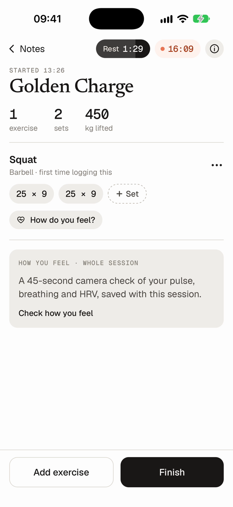
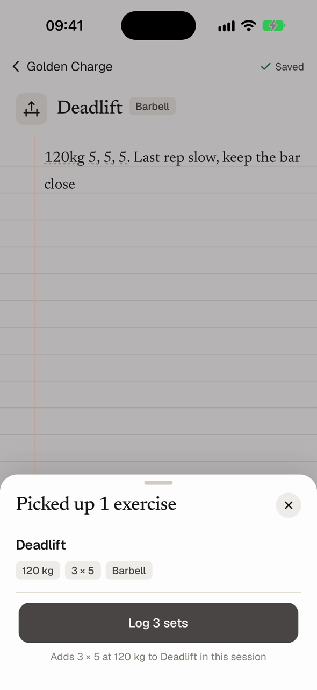
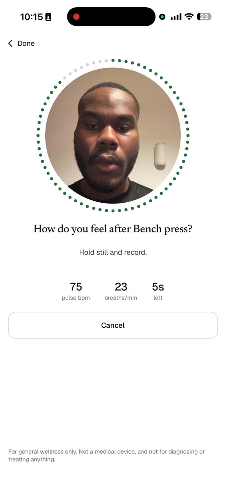
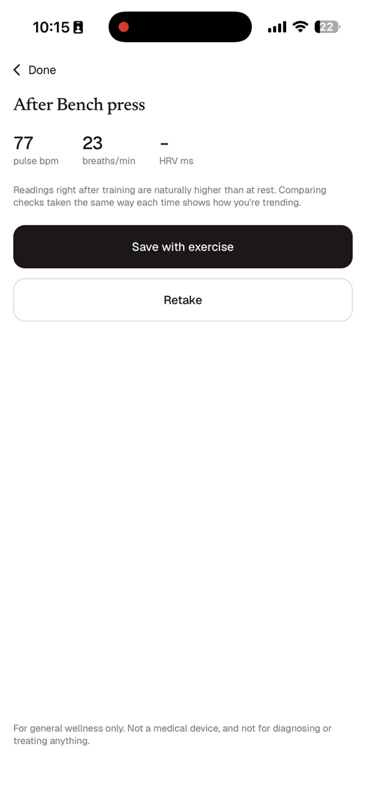
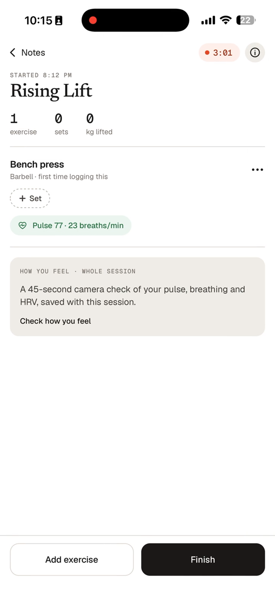
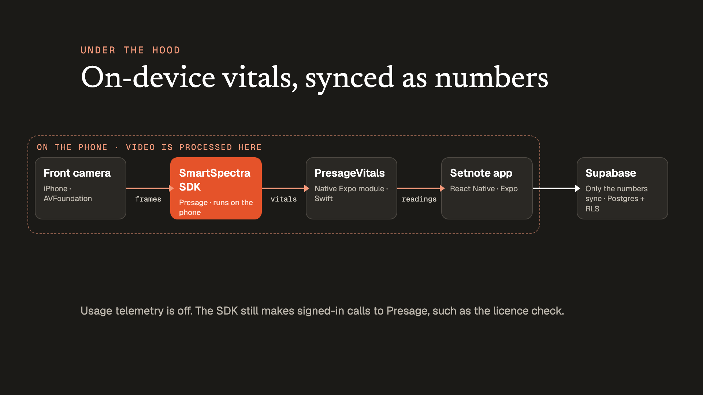

# Setnote

Setnote is a mobile-first training journal built for the Gym Notes Figma and the Presage SmartSpectra SDK challenge. The current implementation includes the Notes home and date strip, standalone and exercise notes, local note extraction, voice capture and clips, structured sessions with set editing and undo, rest and session timers, History, Settings, account flows, custom exercises, unit preferences, and the optional iOS recovery-check flow.

## Screenshots

<table>
  <tr>
    <td align="center" width="20%"><br><sub>Log a set in two taps; the rest timer starts on its own</sub></td>
    <td align="center" width="20%"><br><sub>A typed note becomes sets in one tap</sub></td>
    <td align="center" width="20%"><br><sub>Live SmartSpectra check on an iPhone</sub></td>
    <td align="center" width="20%"><br><sub>The result, before saving</sub></td>
    <td align="center" width="20%"><br><sub>The reading saved with the exercise</sub></td>
  </tr>
</table>

## Architecture



The SmartSpectra SDK reads pulse, breathing and HRV from the front camera on the phone. `modules/presage-vitals` is a local Expo module in Swift that starts and stops the SDK and sends samples to JavaScript every 250 ms. The app keeps the confident samples, saves their median, and syncs only those numbers to Supabase, where row-level security limits each row to its owner. SDK telemetry is off (`enableTelemetry = false`). The SDK's xcframework isn't checked in: `PresageVitals.podspec` downloads it on `pod install` and checks its SHA-256.

## Requirements

- Node.js 20.19 or newer
- Expo SDK 57 / React Native 0.86
- Xcode for iOS builds and Android Studio for Android builds
- A Supabase project for auth and synced workout data
- A custom development build for speech recognition and the Presage native module

Use the version-matched [Expo SDK 57 documentation](https://docs.expo.dev/versions/v57.0.0/) when changing Expo or React Native APIs. Install compatible native dependencies with `npx expo install`.

## Configure Supabase

Copy `.env.example` to `.env.local` and set:

```dotenv
EXPO_PUBLIC_SUPABASE_URL=https://YOUR_PROJECT.supabase.co
EXPO_PUBLIC_SUPABASE_PUBLISHABLE_KEY=YOUR_PUBLISHABLE_KEY
EXPO_PUBLIC_PRESAGE_API_KEY=
```

The app displays a setup message until both Supabase values are set. Only publishable/anon keys belong in the client. Do not put service-role, database-password, or Anthropic keys in any `EXPO_PUBLIC_*` variable.

Apply the checked-in migrations to a new Supabase project with `npm run db:push` after linking the CLI to your project. The migrations create the shared exercise catalog, user-scoped session/set/note tables and policies, account-deletion RPC, private recording/video storage policies, and recovery-check tables. `supabase/tests/rls-smoke.sql` contains a database-side RLS smoke check. Deploy the `delete-account` Edge Function (`supabase functions deploy delete-account`) so account deletion removes storage files and the user on the server; without it the app falls back to deleting from the client. The extraction Edge Function is optional; local parsing remains available without it. Set any model-provider key as a server-side Edge Function secret only.

## Run

```sh
npm install
npm run dev       # native development client
npm run start:web # browser preview
npm run ios       # build/run iOS locally
npm run android   # build/run Android locally
```

Before building the iOS recovery module, configure the Presage SmartSpectra SDK access required by `modules/presage-vitals`. It is hidden when unsupported or when the public API key is absent. Validate readings only on a supported physical iPhone; the app does not simulate measurements.

## Validate

```sh
npm run lint
npm run typecheck
npm test
npm run check
```

`npm test` covers parsing and formatting, dates, notes, optimistic set actions, navigation, settings, voice clips, recovery comparisons, and store behavior. Native permission prompts, Supabase linking, RLS against a live project, and Presage scans require configured services/devices and are not simulated by unit tests.
